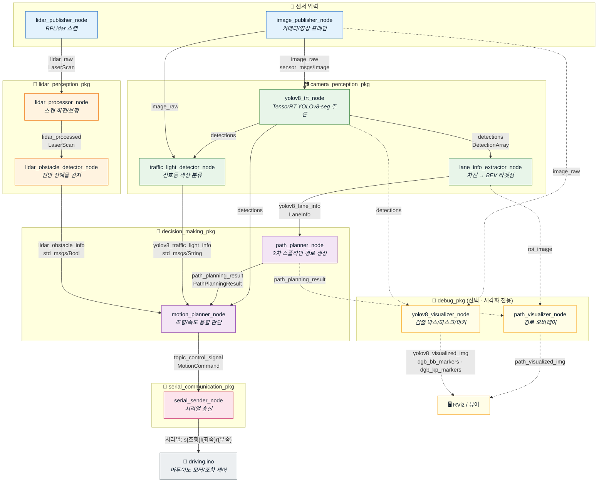

# H-Mobility Autonomous Advanced Course — ROS2 Workspace

카메라 · 라이다 기반 인지(Perception), 경로/모션 계획(Decision Making), 시리얼 통신(Communication)을
하나의 `colcon` 모노레포로 구성한 자율주행 워크스페이스입니다. 최종적으로 ROS2 노드가 계산한
조향/속도 명령을 시리얼로 아두이노(`driving.ino`)에 전달하여 실제 차량을 제어합니다.

## 목차
- [시스템 아키텍처](#시스템-아키텍처)
- [데이터 흐름 요약](#데이터-흐름-요약)
- [폴더 구조](#폴더-구조)
- [핵심 파일 상세](#핵심-파일-상세)
  - [`data_collection.py` — 데이터 수집 & 수동 주행](#data_collectionpy--데이터-수집--수동-주행)
  - [`driving.ino` — 아두이노 차량 제어 펌웨어](#drivingino--아두이노-차량-제어-펌웨어)
- [빌드 & 실행](#빌드--실행)

---

## 시스템 아키텍처

전체 파이프라인은 **센서 → 인지 → 판단 → 통신 → 하드웨어** 순서로 흐릅니다.
아래 다이어그램은 각 ROS2 노드와 그들을 잇는 토픽(메시지 타입)을 나타냅니다.



> **디버그 노드**(`debug_pkg`, 위 다이어그램에서 점선): `path_visualizer_node`는 `roi_image`와
> `path_planning_result`를 받아 경로를 오버레이하고, `yolov8_visualizer_node`는 `image_raw`와
> `detections`를 받아 검출 박스/마스크/키포인트 및 RViz 마커를 발행합니다.
> 주행 파이프라인에는 관여하지 않으며 디버깅 시에만 실행합니다.

### 데이터 흐름 요약

| 단계 | 노드 | 입력 토픽 | 출력 토픽 |
|------|------|-----------|-----------|
| 센서 | `image_publisher_node` | — | `image_raw` |
| 센서 | `lidar_publisher_node` | — | `lidar_raw` |
| 인지 | `yolov8_trt_node` | `image_raw` | `detections` |
| 인지 | `lane_info_extractor_node` | `detections` | `yolov8_lane_info`, `roi_image` |
| 인지 | `traffic_light_detector_node` | `detections`, `image_raw` | `yolov8_traffic_light_info` |
| 인지 | `lidar_processor_node` | `lidar_raw` | `lidar_processed` |
| 인지 | `lidar_obstacle_detector_node` | `lidar_processed` | `lidar_obstacle_info` |
| 판단 | `path_planner_node` | `yolov8_lane_info` | `path_planning_result` |
| 판단 | `motion_planner_node` | `path_planning_result`, `yolov8_traffic_light_info`, `lidar_obstacle_info`, `detections` | `topic_control_signal` |
| 통신 | `serial_sender_node` | `topic_control_signal` | (시리얼 포트) |

핵심 융합 지점은 **`motion_planner_node`** 입니다. 경로(조향), 신호등(정지), 라이다 장애물(정지),
객체 감지를 종합해 `MotionCommand(steering, left_speed, right_speed)`를 만들고, 이를
`serial_sender_node`가 `s{steering}l{left}r{right}\n` 문자열로 변환해 아두이노로 전송합니다.

---

## 폴더 구조

```
ros3_ws/
├── src/                                  # ROS2 소스 패키지 (colcon 워크스페이스)
│   │
│   ├── interfaces_pkg/                    # 🧩 공용 커스텀 메시지 정의 (모든 패키지가 의존)
│   │   └── msg/                           #   MotionCommand, LaneInfo, DetectionArray,
│   │                                      #   PathPlanningResult, BoundingBox2D/3D 등
│   │
│   ├── camera_perception_pkg/            # 📷 카메라 인지
│   │   └── camera_perception_pkg/
│   │       ├── image_publisher_node.py    #   카메라/영상 → image_raw 발행
│   │       ├── yolov8_trt_node.py         #   TensorRT YOLOv8 추론 (GPU, torch 불필요)
│   │       ├── yolov8_node.py             #   Ultralytics YOLOv8 추론 (대체 노드)
│   │       ├── lane_info_extractor_node.py#   차선 검출 → BEV 타겟점/기울기
│   │       ├── traffic_light_detector_node.py # 신호등 색상(HSV) 분류
│   │       └── lib/                        #   인지 함수 라이브러리 + 수집 데이터셋
│   │
│   ├── lidar_perception_pkg/             # 📡 라이다 인지
│   │   └── lidar_perception_pkg/
│   │       ├── lidar_publisher_node.py    #   RPLidar 시리얼 → LaserScan 발행
│   │       ├── lidar_processor_node.py    #   스캔 회전/반전 보정
│   │       ├── lidar_obstacle_detector_node.py # 전방 장애물 유무 판단
│   │       └── lib/
│   │
│   ├── decision_making_pkg/              # 🧠 판단/계획
│   │   └── decision_making_pkg/
│   │       ├── path_planner_node.py       #   타겟점 → 3차 스플라인 경로
│   │       ├── motion_planner_node.py     #   인지 결과 융합 → 조향/속도 명령
│   │       └── lib/
│   │
│   ├── serial_communication_pkg/        # 🔌 시리얼 통신
│   │   └── serial_communication_pkg/
│   │       ├── serial_sender_node.py      #   MotionCommand → 시리얼 문자열 송신
│   │       └── lib/protocol_convert_func_lib.py # 프로토콜 변환
│   │
│   ├── debug_pkg/                        # 🐞 시각화/디버그 (선택)
│   │   └── debug_pkg/
│   │       ├── path_visualizer_node.py    #   경로를 ROI 이미지에 오버레이
│   │       └── yolov8_visualizer_node.py  #   검출 박스/마스크/키포인트 시각화
│   │
│   ├── launch_pkg/                       # 🚀 통합 실행
│   │   └── launch/main.launch.py          #   전체 노드 일괄 실행
│   │
│   ├── control/                          # ⚙️ 아두이노 펌웨어 (.ino)
│   │   ├── driving/driving.ino            #   ★ 실주행 제어 펌웨어
│   │   ├── motor_test/                    #   모터 테스트
│   │   ├── ultrasonic/                    #   초음파 센서 테스트
│   │   └── check_variable_resistor(_EMA)/ #   조향 가변저항 캘리브레이션
│   │
│   └── data_collection/                 # 📥 학습 데이터 수집
│       └── data_collection.py             #   ★ 수동 주행 + 이미지/라벨 수집
│
├── best.pt / best.onnx / best.engine    # 학습된 차선 검출 모델(파이토치/ONNX/TensorRT)
├── yolov8m.pt                           # YOLOv8 사전학습 가중치
├── bev_calibrator.py                    # BEV(조감도) 캘리브레이션 도구
├── install.sh                           # 의존성 설치 스크립트
├── build/ · install/ · log/             # colcon 빌드 산출물 (git 미추적)
└── H-Mobility-...-강의교안.pdf           # 강의 교안
```

---

## 핵심 파일 상세

### `data_collection.py` — 데이터 수집 & 수동 주행

> 경로: [`src/data_collection/data_collection.py`](src/data_collection/data_collection.py)

딥러닝 학습용 데이터셋을 모으기 위한 **수동 주행 도구**입니다. ROS2 파이프라인과 별개로 동작하며,
키보드 입력으로 차량을 직접 조종하는 동시에 카메라 프레임과 조향 라벨을 저장합니다.

**동작 방식**

1. 같은 폴더의 사전 컴파일된 `data_collection_func_lib.cpython-310.pyc`를 `marshal`로 로드해
   `Data_Collect` 클래스를 동적으로 불러옵니다. (실제 수집/키 입력 로직은 이 라이브러리에 은닉)
2. `Data_Collect(path, cam_num, max_steering)` 객체와 시리얼 포트(`/dev/ttyACM0`, 115200bps)를 초기화합니다.
3. 메인 루프에서 매 반복마다:
   - `data_collector.process()` — 키보드 입력 1회 처리 (조향/속도 갱신 및 프레임 저장)
   - `get_control_values()` — 현재 조향/좌·우 속도 값 조회
   - 시리얼로 **`s{steering}l{left_speed}r{right_speed}\n`** 형식 문자열 송신 → 아두이노 구동
4. 종료 플래그, `KeyboardInterrupt`, `finally` 어느 경로로든 마지막에 **`s0l0r0\n`(정지)** 을 보내
   차량을 안전하게 멈추고 포트/리소스를 정리합니다.

**주요 설정 값**

| 변수 | 기본값 | 설명 |
|------|--------|------|
| `DATA_PATH` | `.../camera_perception_pkg/lib/Collected_Datasets` | 수집 이미지 저장 경로 |
| `CAMERA_NUM` | `0` | 사용할 카메라 인덱스 |
| `SERIAL_PORT` | `/dev/ttyACM0` | 아두이노 시리얼 포트 |
| `MAX_STEERING` | `5` | 최대 조향 단계 (한 쪽 기준) |

> 📌 이 스크립트가 보내는 시리얼 프로토콜은 아래 `driving.ino`가 파싱하는 형식과 **동일**합니다.
> 즉 수집 단계와 실주행 단계에서 동일한 펌웨어를 그대로 사용할 수 있습니다.

---

### `driving.ino` — 아두이노 차량 제어 펌웨어

> 경로: [`src/control/driving/driving.ino`](src/control/driving/driving.ino)

`serial_sender_node`(자율주행) 또는 `data_collection.py`(수동)가 보낸 시리얼 명령을 받아
**조향 모터**와 **좌/우 구동 모터**를 실제로 구동하는 아두이노 펌웨어입니다.

**시리얼 프로토콜**

```
s{steering}l{left_speed}r{right_speed}\n     예) s3l100r100\n
```
- `s` : 조향 단계 (`-MAX_STEERING_STEP` ~ `+MAX_STEERING_STEP`, 범위 초과 시 클램프)
- `l` / `r` : 좌 · 우 모터 속도 (부호로 전/후진, `analogWrite` PWM 값)
- 한 줄(`\n`)이 하나의 완전한 명령 패킷

**핀 구성**

| 기능 | 핀 |
|------|-----|
| 조향 모터 | `STEERING_1=4`, `STEERING_2=5` |
| 우측 구동 모터 | `FORWARD_RIGHT_1=2`, `FORWARD_RIGHT_2=3` |
| 좌측 구동 모터 | `FORWARD_LEFT_1=6`, `FORWARD_LEFT_2=7` |
| 조향각 피드백(가변저항) | `POT=A2` |

**제어 로직 (`loop`)**

1. **시리얼 수신** — `processIncomingByte()`가 바이트를 버퍼링하다 `\n`에서 한 패킷을 완성하고
   `processData()`가 `s/l/r` 토큰을 파싱해 목표 조향/속도를 갱신합니다. (동일 명령은 무시)
2. **폐루프 조향 제어** — 가변저항(`POT`)으로 현재 조향각을 읽어 `map()`으로 단계화한 뒤,
   목표값과 비교해 `steerLeft()` / `steerRight()` / `maintainSteering()`으로 조향 모터를 구동합니다.
3. **모터 구동** — `setLeftMotorSpeed()` / `setRightMotorSpeed()`가 속도 부호에 따라
   H-브리지 방향을 정하고 PWM으로 출력합니다.
4. **주기 제한** — 최소 `COMMAND_INTERVAL = 50ms` 간격으로만 제어를 실행해 통신/모터 부하를 완화합니다.

**⚠️ 통신 워치독 (안전장치)**

`COMMAND_TIMEOUT = 500ms` 동안 유효한 명령이 들어오지 않으면(ROS 노드 크래시·USB 분리 등)
좌/우 속도를 강제로 `0`으로 만들어 차량을 정지시킵니다. `processData()`에서 유효 패킷을 받을 때마다
`lastValidCommandTime`을 갱신해 워치독을 리셋합니다.

**주요 상수**

| 상수 | 값 | 설명 |
|------|-----|------|
| `MAX_STEERING_STEP` | `5` | 조향 최대 단계 (한 쪽 기준) |
| `STEERING_SPEED` | `128` | 조향 모터 PWM 세기 |
| `resistance_most_left/right` | `300` / `500` | 가변저항 좌/우 끝값 (캘리브레이션 대상) |
| `COMMAND_INTERVAL` | `50 ms` | 제어 실행 최소 주기 |
| `COMMAND_TIMEOUT` | `500 ms` | 통신 두절 시 정지까지의 시간 |

---

## 빌드 & 실행

```bash
# 1) 의존성 설치
./install.sh

# 2) 빌드
colcon build --symlink-install
source install/setup.bash

# 3) 전체 파이프라인 실행 (자율주행)
ros2 launch launch_pkg main.launch.py

# (선택) 학습 데이터 수집 — 수동 주행
python3 src/data_collection/data_collection.py
```

> 아두이노에는 `src/control/driving/driving.ino`를 업로드해 두어야 하며,
> `data_collection.py` · `serial_sender_node`의 시리얼 포트(`/dev/ttyACM0`)가
> 실제 연결 포트와 일치해야 합니다.
